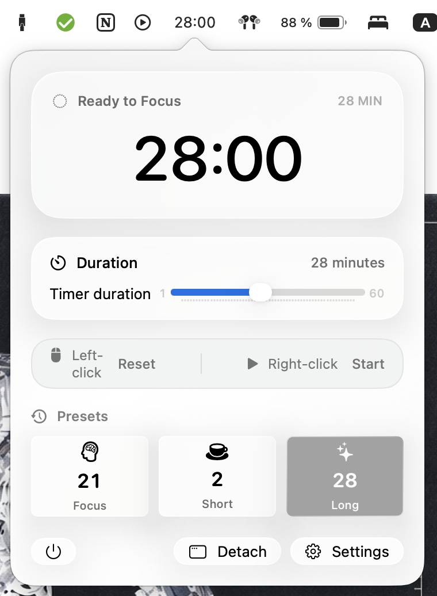

# Cloud

Cloud 2.0 is a free, minimal Pomodoro timer for macOS that lives in the menu bar.



## Features

- Custom Focus, Short Break, and Long Break presets
- Adjustable timer duration with direct numeric entry
- Start, pause, resume, and reset controls
- Optional mouse mode: single-click the timer to start or pause, and triple-click to reset
- Optional Zen Mode that hides setup controls while the timer is running
- Resizable, detachable timer window with dynamic type sizing
- Launch at Login support
- No ads and no data collection

## Requirements

- macOS 14 or later
- Xcode with support for building macOS 14 applications

## Build from source

1. Clone the repository:

   ```sh
   git clone https://github.com/YYUUGGOO/Cloud.git
   cd Cloud
   ```

2. Open `Timer.xcodeproj` in Xcode.
3. Allow Xcode to resolve the Swift package dependency.
4. Select the `Timer` scheme and build or run the app.

## Controls

Cloud uses standard on-screen buttons by default. You can switch to mouse controls in **Settings → General**.

In mouse mode:

- Single-click the timer display to start, pause, or resume.
- Triple-click the timer display to reset.

Zen Mode is disabled by default. When enabled, duration and preset controls are hidden while the timer is running and return when it is paused or reset.

## Dependency

- [LaunchAtLogin-Modern](https://github.com/sindresorhus/LaunchAtLogin-Modern)


## Open source

Cloud is open-source software. Source code, issues, and releases are available at [YYUUGGOO/Cloud](https://github.com/YYUUGGOO/Cloud).

## License

Cloud is licensed under the GNU General Public License v3.0.

## Donation
If you feel inclined to support the work I do, you can do so using ko-fi.

[](https://ko-fi.com/Q5Q31Q4X0W)
